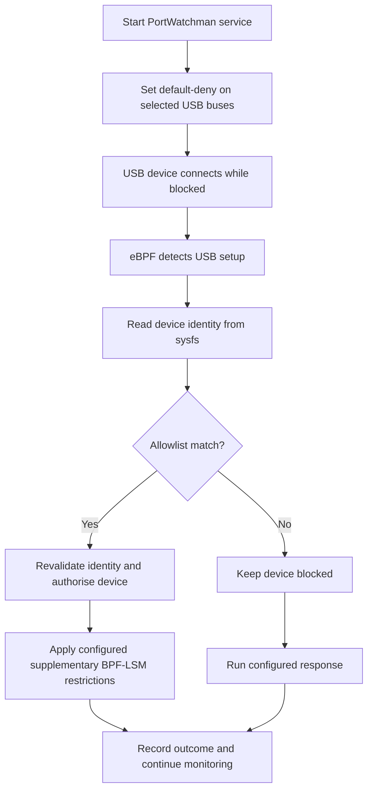

# PortWatchman

PortWatchman is a Linux USB monitoring, allowlisting, and enforcement project developed for ICT3215 Digital Forensics at the Singapore Institute of Technology. It explores an event-driven approach to USB access control and configurable anti-forensic responses using eBPF, a user-space policy component, Linux USB authorisation, and supplementary BPF-LSM restrictions.

The intended behaviour is to keep newly connected USB devices blocked until their reported attributes satisfy the allowlist. Unapproved devices remain blocked and can trigger a configured response, such as session locking or shutdown.

**Current implementation:** USB monitoring and device identification/allowlist decisions are implemented and tested. Automatic USB enforcement, the integrated BPF-LSM layer, response actions, and the running service are still planned. An `allow` or `block` decision currently does not change device access; policy output reports `enforcement_applied: false`.

## Architecture

The intended end-to-end flow is:



The currently implemented pipeline is:

```text
USB event -> eBPF monitor -> JSON event -> device identification -> allow/block decision
```

## Development environment

Development and live testing currently target one Ubuntu VM configuration:

| Component | Validated environment |
| --- | --- |
| Guest operating system | Ubuntu 24.04.5 LTS |
| Virtualisation | VMware on a Windows laptop, with USB passthrough |
| Kernel | `7.0.0-38-generic` |
| Monitoring backend | bpftrace `0.20.2` |
| BPF development tools | Clang `18.1.3`, libbpf `1.3.0` |
| Python | Python 3.10 or later; standard library only for current components |

The kernel must support eBPF and expose BTF at `/sys/kernel/btf/vmlinux`. The supplementary BPF-LSM work also requires `bpf` in the active LSM list. Live monitoring requires root privileges.

This environment has been validated for the prototype. Compatibility with other kernels, distributions, and physical machines remains subject to testing. Enforcement inside the VM applies to devices connected to the Ubuntu guest.

Install the development dependencies in Ubuntu:

```bash
sudo apt update
sudo apt install -y git python3 bpftrace clang llvm build-essential libbpf-dev libelf-dev pkg-config
```

## Run the project

Run commands from the repository root in the Ubuntu VM. The following is an example, replace to your own repository root directory: 

```bash
cd ~/df/project/portwatchman
```

### Overall application — placeholder

The combined application entry point and service installation commands are not implemented yet.

```bash
# TODO: Add the overall PortWatchman launch command after service integration.
# TODO: Add service installation, start, status, and stop commands.
```

Until then, use the monitoring and policy commands below.

### Check prerequisites and policy

```bash
sudo python3 src/monitor/usb_monitor.py --check
python3 src/policy/device_policy.py validate
```

The monitor check verifies prerequisites and probe availability. It does not load the monitoring program or prove live event delivery. The policy check validates `config/allowlist.json`.

### Run the current monitor-to-policy pipeline

Start with the test USB drive disconnected:

```bash
set -o pipefail
sudo python3 src/monitor/usb_monitor.py |
  python3 src/policy/device_policy.py watch
```

Wait for a `policy_monitor_status` record with `healthy: true`, then connect the USB drive to Ubuntu through VMware. A successful USB setup produces a policy decision. The default policy has no allowlist rules, so unmatched devices receive a `block` decision.

To test with the supplied example policy:

```bash
sudo python3 src/monitor/usb_monitor.py |
  python3 src/policy/device_policy.py --policy config/allowlist.example.json watch
```

The example contains a lab flash-drive rule matching vendor ID `058f` and product ID `6387`. Use the example only when it matches your intended test device.

Press **Ctrl+C** to stop. Unmount any mounted USB filesystem before unplugging the drive. Check that the monitoring backend has exited:

```bash
pgrep -af 'bpftrace.*usb_events[.]bt'
```

No matching process is expected after a normal stop.

### Save policy decisions

```bash
mkdir -p logs
sudo python3 src/monitor/usb_monitor.py |
  python3 src/policy/device_policy.py watch > logs/device-decisions.jsonl
```

From another terminal:

```bash
tail -f logs/device-decisions.jsonl
```

Output uses newline-delimited JSON: one JSON record per line. The `logs/` directory is ignored by Git.

### Run the monitor independently

```bash
sudo python3 src/monitor/usb_monitor.py
```

For a timed run:

```bash
sudo python3 src/monitor/usb_monitor.py --duration 60
```

Events include USB setup starting, setup completing or failing, disconnection, heartbeats, and monitoring diagnostics. Connection IDs distinguish successive connections at the same USB port.

### Inspect and evaluate devices

List devices first:

```bash
python3 src/policy/device_policy.py list
```

Then use the USB ID shown for the intended device. The following example uses `1-1`; replace it if your current device has a different ID:

```bash
python3 src/policy/device_policy.py inspect 1-1
python3 src/policy/device_policy.py evaluate 1-1
python3 src/policy/device_policy.py --policy config/allowlist.example.json evaluate 1-1
```

USB IDs and bus numbers can change across boots or VM configuration changes. Confirm the vendor/product IDs before selecting a device. `kernel_authorized` describes the existing kernel state; `action` describes the policy decision.

## Allowlist configuration

The default policy is `config/allowlist.json`:

```json
{
  "schema_version": 1,
  "default_action": "block",
  "allowlist": []
}
```

Each rule requires a unique `name`, a `vendor_id`, and a `product_id`. Optional `serial` and `usb_id` constraints narrow the match. All constraints in a rule must match; the first matching rule wins. Serial matching is exact and case-sensitive.

The CLI can manage rules in the selected local policy file:

```bash
python3 src/policy/device_policy.py add-rule \
  --name lab-flash-drive \
  --vendor-id 058f \
  --product-id 6387 \
  --serial F7633B53

python3 src/policy/device_policy.py validate

python3 src/policy/device_policy.py remove-rule --name lab-flash-drive
```

These values identify the current lab drive. Inspect your own device before adding a rule. These commands edit the local JSON file; commit and push configuration changes through your chosen Git workflow.

The global `--policy` option goes **before** the command. The watcher reloads the policy for each new setup-completed event. Policy edits do not currently revoke existing access or re-evaluate previously processed connections.

## Directory structure

Current repository layout:

```text
portwatchman/
├── README.md
├── .gitattributes                  # Line-ending settings
├── .gitignore
├── config/
│   ├── allowlist.json               # Default policy: block, no rules
│   └── allowlist.example.json       # Example lab-device rule
├── src/
│   ├── monitor/
│   │   ├── usb_events.bt           # eBPF probe definitions
│   │   └── usb_monitor.py          # Monitor supervision and JSON output
│   └── policy/
│       └── device_policy.py        # Identification, policy rules, and CLI
├── tests/
│   ├── test_usb_monitor.py
│   └── test_device_policy.py
├── docs/
│   ├── STEP3-TESTING.md
│   └── STEP4-TESTING.md
├── logs/                           # Local output; created as needed, ignored
└── build/                          # Local build/test files; ignored
```

Planned additions — these paths are placeholders and may change during implementation:

```text
src/
├── enforcement/                    # USB authorisation and BPF-LSM components
├── responses/                      # Configurable response actions
└── daemon/                         # Application lifecycle and integration
config/
└── <response-and-service-config>   # Format and filename to be decided
```

## Testing

Run the automated tests from the repository root:

```bash
python3 -m unittest discover -s tests -p 'test_*.py' -v
```

At completion of step 4, all **58 tests** passed in the Ubuntu VM. Live tests also verified USB reconnection monitoring, connection correlation, allowlist matches and mismatches, identification while unauthorised, and normal backend cleanup.

See [step 3 testing](docs/STEP3-TESTING.md) and [step 4 testing](docs/STEP4-TESTING.md) for detailed procedures. Treat device IDs in those guides as examples and rediscover the current topology before testing.

## Implementation progress

- [x] 1. Set up the development environment and shared repository.
- [x] 2. Validate technical feasibility in the Ubuntu VM.
- [x] 3. Implement USB event monitoring.
- [x] 4. Implement device identification and allowlisting.
- [ ] 5. Implement automatic USB access control.
- [ ] 6. Implement supplementary BPF-LSM enforcement.
- [ ] 7. Implement configurable responses.
- [ ] 8. Integrate components into a running service.
- [ ] 9. Handle failures, recovery, and edge cases.
- [ ] 10. Test and evaluate the complete solution.
- [ ] 11. Stabilise the final demonstration.

## Scope and limitations

- USB authorisation and a narrow BPF-LSM test have been demonstrated manually. They are not yet integrated with policy decisions.
- BPF-LSM feasibility testing restricted new opens of one designated USB test file. It does not establish whole-volume, raw-device, or all-interface enforcement.
- Vendor/product IDs and serial numbers are device-reported attributes and can be spoofed. A policy match does not authenticate physical identity.
- The current watcher processes new setup events. Automatic startup inventory, recovery reconciliation, and existing-device enforcement remain planned.
- Current JSON output supports development testing; durable audit logging and service supervision remain planned.
- Session locking, shutdown/reboot, secure deletion, and data sanitisation are not implemented. Secure deletion and sanitisation require further feasibility work; reliable evidence erasure is not an established project capability.
- Timing measurements inside VMware describe guest behaviour. They do not establish physical insertion latency or erase data retained by the Windows host or VM snapshots.
