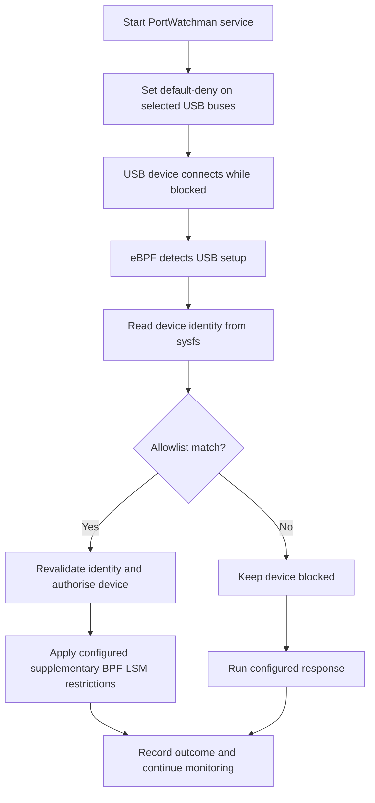

# PortWatchman

PortWatchman is a Linux USB monitoring, allowlisting, and enforcement project developed for ICT3215 Digital Forensics at the Singapore Institute of Technology. It explores an event-driven approach to USB access control and configurable anti-forensic responses using eBPF, a user-space policy component, Linux USB authorisation, and supplementary BPF-LSM restrictions.

The intended behaviour is to keep newly connected USB devices blocked until their reported attributes satisfy the allowlist. Unapproved devices remain blocked and can trigger a configured response, such as session locking or shutdown.

**Current implementation:** USB monitoring, device identification/allowlist decisions, and USB access control are implemented and tested. Access control sets default-deny on managed USB buses, authorises allowed devices after re-validating them, keeps unapproved devices blocked, and reconciles devices connected before it started. Supplementary selected-file BPF-LSM enforcement, its root-only Unix socket and opt-in Python bridge are implemented and verified in the recorded Ubuntu VM environment, including coordinated USB removal/reconnection and report-only failure handling. Service orchestration and response actions remain planned. The policy watcher on its own still reports `enforcement_applied: false`; device access changes only when its decisions are piped into the enforcement stage.

## Architecture

The intended end-to-end flow is:



The currently implemented pipeline is:

```text
USB event -> eBPF monitor -> JSON event -> device identification -> allow/block decision
  -> re-validation -> USB authorisation (authorise or keep blocked)
  -> optional BPF-LSM bridge -> selected-file registration after mount
```

## Development environment

Development and live testing currently target one Ubuntu VM configuration:

| Component | Validated environment |
| --- | --- |
| Guest operating system | Ubuntu 24.04.5 LTS |
| Virtualisation | VMware on a Windows laptop, with USB passthrough |
| Kernel | `7.0.0-38-generic`; `7.0.0-42-generic` for step 5 live tests |
| Monitoring backend | bpftrace `0.20.2` |
| BPF development tools | Clang `18.1.3`, libbpf `1.3.0` |
| Python | Python 3.10 or later; standard library only for current components |

The kernel must support eBPF and expose BTF at `/sys/kernel/btf/vmlinux`. The supplementary BPF-LSM work also requires `bpf` in the active LSM list. Live monitoring requires root privileges.

This environment has been validated for the prototype. Compatibility with other kernels, distributions, and physical machines remains subject to testing. Enforcement inside the VM applies to devices connected to the Ubuntu guest.

Install the development dependencies in Ubuntu:

```bash
sudo apt update
sudo apt install -y git python3 bpftrace clang llvm linux-tools-common build-essential libbpf-dev libelf-dev libjson-c-dev pkg-config
```

### Build and test the supplementary BPF-LSM guard

Step 6 adds a guard for new opens of selected regular file identities on verified
USB-backed filesystems. It includes a foreground C/libbpf controller, root-only
Unix socket (ADD/REMOVE/LIST/STATUS/PREPARE_REMOVE/STOP), denial counters, target-lifetime checks,
an opt-in Python bridge tied to USB connection IDs, and an explicit loopback test mode.
Building requires Clang, GCC, bpftool, pkg-config, libbpf-dev, libelf-dev and
libjson-c-dev. Generated headers, skeletons and binaries stay in the ignored build
directory and are regenerated locally.

```bash
bash src/enforcement/bpf/build.sh
sudo src/enforcement/bpf/build/lsm_controller --check
python3 -m unittest discover -s tests -p 'test_*.py' -v
sudo python3 tests/enforcement/test_bpf_lsm.py --loopback
```

For physical USB acceptance, first authorise/mount the intended test drive, verify
its actual mount path, and use:

```bash
lsblk -o NAME,TRAN,SIZE,FSTYPE,MOUNTPOINTS
USB_MOUNT='/path/to/mounted/usb'
findmnt -T "$USB_MOUNT" -o SOURCE,TARGET,FSTYPE
sudo python3 tests/enforcement/test_bpf_lsm.py --usb "$USB_MOUNT"
```

Replace the mount-directory placeholder with the USB filesystem's actual mounted directory, not its block-device path. The runner creates and removes an owned fixture
directory; it does not select pre-existing user files. See
[step 6 testing](docs/STEP6-TESTING.md) for manual tests, controls, and scope.
Step 6 passed the Ubuntu build, all 181 tests, loopback and physical USB checks,
live bridge registration/reconnect, rejection and report-only controller-loss tests.
Another environment must rerun acceptance; a Python suite alone does not prove attachment. The guard follows file identity,
not replacement pathnames; it does not cover existing data descriptors, raw devices,
mount operations, mmap, HID interfaces, or every hotplug race.

Held file references keep protected mounts busy. With the Python bridge running,
use `sudo python3 src/enforcement/lsm_client.py PREPARE_REMOVE CONNECTION_ID`, wait
for `lsm_bridge_prepared_for_removal`, then unmount normally before disconnecting.
This deliberately ends protection for that connection and lets the same pipeline
register a new generation after reconnecting. The guide includes a live-status
lookup to select the current connection without copying an obsolete ID.

## Run the project

Run the Bash commands from your clone's repository root in the Linux system under test. Replace the quoted path with its actual location:

```bash
cd '/path/to/portwatchman'
```

### Overall application — placeholder

The combined application entry point and service installation commands are not implemented yet.

```bash
# TODO: Add the overall PortWatchman launch command after service integration.
# TODO: Add service installation, start, status, and stop commands.
```

Until then, use the monitoring, policy, and access-control commands below.

### Check prerequisites and policy

```bash
sudo python3 src/monitor/usb_monitor.py --check
python3 src/policy/device_policy.py validate
```

The monitor check verifies prerequisites and probe availability. It does not load the monitoring program or prove live event delivery. The policy check validates `config/allowlist.json`.

### Run the current monitor-to-policy pipeline

Start with the test USB drive disconnected:

```bash
set -o pipefail
sudo python3 src/monitor/usb_monitor.py |
  python3 src/policy/device_policy.py watch
```

Wait for a `policy_monitor_status` record with `healthy: true`, then connect the USB drive to Ubuntu through VMware. A successful USB setup produces a policy decision. The default policy has no allowlist rules, so unmatched devices receive a `block` decision.

To test approval for your own drive, generate a matching local policy using
[shared testing setup](docs/TESTING-SETUP.md), then run:

```bash
sudo python3 src/monitor/usb_monitor.py |
  python3 src/policy/device_policy.py --policy logs/test-allow.json watch
```

The shipped `config/allowlist.example.json` illustrates the policy format and does
not identify an arbitrary user's drive. The generated test policy uses the attributes
of the device you inspected instead.

Press **Ctrl+C** to stop. Unmount any mounted USB filesystem before unplugging the drive. Check that the monitoring backend has exited:

```bash
pgrep -af 'bpftrace.*usb_events[.]bt'
```

No matching process is expected after a normal stop.

### Save policy decisions

```bash
mkdir -p logs
sudo python3 src/monitor/usb_monitor.py |
  python3 src/policy/device_policy.py watch > logs/device-decisions.jsonl
```

From another terminal:

```bash
tail -f logs/device-decisions.jsonl
```

Output uses newline-delimited JSON: one JSON record per line. The `logs/` directory is ignored by Git.

### Run the monitor independently

```bash
sudo python3 src/monitor/usb_monitor.py
```

For a timed run:

```bash
sudo python3 src/monitor/usb_monitor.py --duration 60
```

Events include USB setup starting, setup completing or failing, disconnection, heartbeats, and monitoring diagnostics. Connection IDs distinguish successive connections at the same USB port.

### Inspect and evaluate devices

List devices first:

```bash
python3 src/policy/device_policy.py list
```

Select the device-level USB ID for your intended test drive, then replace the placeholder below. Keep this variable consistent across inspection and authorisation commands:

```bash
USB_ID='REPLACE_WITH_USB_ID'
python3 src/policy/device_policy.py inspect "$USB_ID"
python3 src/policy/device_policy.py evaluate "$USB_ID"
```

USB IDs and bus numbers can change across boots or VM configuration changes. Confirm the vendor/product IDs before selecting a device. `kernel_authorized` describes the existing kernel state; `action` describes the policy decision.

### USB access control

These commands change USB authorisation on the Linux system running them; inside a VM they affect devices connected to the guest. `arm`, `restore`, `authorize`, `revoke` and `reconcile` are dry runs unless `--apply` is supplied. **`enforce` writes by default; use `enforce --dry-run` to prevent writes.** Live writes need `sudo`. After `arm --apply`, any newly connected device (including a USB mouse or keyboard passed through to the VM) starts blocked until it is authorised, so keep the VMware console available. `restore --apply` undoes default-deny.

Check the managed buses, then set default-deny and later restore it:

```bash
python3 src/enforcement/usb_authorization.py status
sudo python3 src/enforcement/usb_authorization.py arm --apply
sudo python3 src/enforcement/usb_authorization.py restore --apply
```

With default-deny armed, run the USB-authorisation pipeline so allowed devices are authorised and others stay blocked. Set `POLICY` to your own validated policy file and use it for both stages. The optional Step 6 bridge is enabled separately below:

```bash
POLICY='/path/to/your/allowlist.json'
set -o pipefail
sudo -v
sudo python3 src/monitor/usb_monitor.py |
  python3 src/policy/device_policy.py --policy "$POLICY" watch |
  sudo python3 src/enforcement/usb_authorization.py --policy "$POLICY" enforce
```

`enforce` acts only on the buses in `config/enforcement.json`; its first record lists them and warns about any that are not armed. Wait for an `enforcement_monitor_status` record with `healthy: true`, then connect the device. Each device produces an `enforcement_result` with `action` (`allow` or `block`), `enforcement_applied`, the policy's `policy_reason`, and `enforcement_latency_ns`. Decisions that cannot be tied safely to the device now on the port, or that target an unmanaged bus, are reported as `enforcement_skipped` and change nothing; a failed sysfs write is reported as `enforcement_error`. Press **Ctrl+C** to stop; the stage ends with an `enforcement_stream_closed` record. Its exit status is non-zero if the upstream pipeline ended unexpectedly or any write failed.

To handle devices that were already connected before the pipeline started:

```bash
sudo python3 src/enforcement/usb_authorization.py --policy "$POLICY" reconcile --apply
```

Single devices can also be authorised (after re-validation against the policy) or revoked:

```bash
sudo python3 src/enforcement/usb_authorization.py --policy "$POLICY" authorize "$USB_ID" --apply
sudo python3 src/enforcement/usb_authorization.py revoke "$USB_ID" --apply
```

Find the current USB ID with `device_policy.py list` first. For reproducible tests,
[shared setup](docs/TESTING-SETUP.md) generates policies from your inspected device
and a selected-bus config; the [Step 5 guide](docs/STEP5-TESTING.md) uses those files.

### Enable the supplementary BPF-LSM bridge

Prepare and review the local test configuration and disposable files using
[Step 6 preparation](docs/STEP6-TESTING.md#round-4--manual-socket-demonstration-and-bridge-fixture).
The following uses its generated files, not the shipped lab-device example.
Unmount/disconnect the test drive, then arm the same selected-bus configuration:

```bash
sudo python3 src/enforcement/usb_authorization.py \
  --config logs/test-enforcement.json arm --apply
```

Terminal A, from the repository root:

```bash
sudo src/enforcement/bpf/build/lsm_controller --usb --serve
```

Terminal B, from the repository root:

```bash
set -o pipefail
sudo -v
sudo python3 src/monitor/usb_monitor.py |
  python3 src/policy/device_policy.py --policy logs/test-allow.json watch |
  sudo python3 src/enforcement/usb_authorization.py \
    --config logs/test-enforcement.json --policy logs/test-allow.json \
    enforce --lsm-config logs/test-lsm.json
```

Reconnect after healthy monitoring. The bridge waits for the authorised filesystem
to mount, then registers the configured **relative file paths**. Expect
`lsm_bridge_registered` with `protection_complete: true` before claiming protection.
There is an access window between authorisation and registration. The generated
config uses `on_error: report`: failures are reported while the USB remains
authorised; this policy was live-tested. `deauthorize` is an explicit alternative
with unit coverage, but its live behaviour has not been validated.

Follow the [Step 6 guide](docs/STEP6-TESTING.md) for normal shutdown, coordinated
removal, reconnect, failure testing and restoring the saved bus defaults. The bridge
does not register files for direct `authorize` or `reconcile` calls.

## Allowlist configuration

The default policy is `config/allowlist.json`:

```json
{
  "schema_version": 1,
  "default_action": "block",
  "allowlist": []
}
```

Each rule requires a unique `name`, a `vendor_id`, and a `product_id`. Optional `serial` and `usb_id` constraints narrow the match. All constraints in a rule must match; the first matching rule wins. Serial matching is exact and case-sensitive. Use the vendor/product IDs and serial reported by inspection when constructing a rule.

The CLI can manage rules in the selected local policy file:

```bash
VENDOR_ID='REPLACE_WITH_4_HEX_DIGITS'
PRODUCT_ID='REPLACE_WITH_4_HEX_DIGITS'
SERIAL='REPLACE_WITH_INSPECTED_SERIAL'

python3 src/policy/device_policy.py add-rule \
  --name trusted-usb \
  --vendor-id "$VENDOR_ID" \
  --product-id "$PRODUCT_ID" \
  --serial "$SERIAL"

python3 src/policy/device_policy.py validate

python3 src/policy/device_policy.py remove-rule --name trusted-usb
```

Replace the placeholders before running the command. If the device has no serial, omit `--serial`; the match is then less specific. These commands edit the selected local JSON policy, not USB authorisation. The shared testing setup instead writes isolated policies under ignored `logs/`.

The global `--policy` option goes **before** the command. The watcher reloads the policy for each new setup-completed event. Policy edits do not currently revoke existing access or re-evaluate previously processed connections.

## Access-control configuration

`config/enforcement.json` selects the buses that receive default-deny and where the original bus settings are saved:

```json
{
  "schema_version": 1,
  "managed_buses": "auto",
  "state_file": "logs/enforcement-state.json"
}
```

`"auto"` manages every USB bus. This is the default because the same device can enumerate on a different controller across reconnects, which would bypass default-deny on an unmanaged bus. To manage specific buses, list them, for example `["usb2", "usb3"]` (see `config/enforcement.example.json`). The original `authorized_default` values are saved before any bus is changed, so `restore` returns the true originals even if `arm` runs more than once.

## Directory structure

Current repository layout:

```text
portwatchman/
├── README.md
├── .gitattributes                  # Line-ending settings
├── .gitignore
├── config/
│   ├── allowlist.json               # Default policy: block, no rules
│   ├── allowlist.example.json       # Example lab-device rule
│   ├── enforcement.json             # Access control: managed buses ("auto"), state file
│   ├── enforcement.example.json     # Example with explicit bus list
│   └── lsm-bridge.example.json      # Illustrative rule-to-relative-file mapping
├── src/
│   ├── monitor/
│   │   ├── usb_events.bt           # eBPF probe definitions
│   │   └── usb_monitor.py          # Monitor supervision and JSON output
│   ├── policy/
│   │   └── device_policy.py        # Identification, policy rules, and CLI
│   └── enforcement/
│       ├── usb_authorization.py    # Default-deny, authorise/revoke, enforce, reconcile
│       ├── lsm_client.py           # Root Unix socket client
│       ├── lsm_bridge.py           # Opt-in policy/connection-to-target bridge
│       └── bpf/                    # Step 6 guard, target resolver, socket controller and build script
├── tests/
│   ├── test_usb_monitor.py
│   ├── test_device_policy.py
│   ├── test_usb_authorization.py
│   ├── test_lsm_controller.py       # Native CLI safety tests after Linux build
│   ├── test_lsm_bridge.py           # Socket client, bridge and resolver tests
│   └── enforcement/                # Root-only BPF acceptance runner
├── docs/
│   ├── TESTING-SETUP.md            # Portable device selection and local test configs
│   ├── STEP3-TESTING.md
│   ├── STEP4-TESTING.md
│   ├── STEP5-TESTING.md
│   └── STEP6-TESTING.md
├── logs/                           # Local output; created as needed, ignored
└── build/                          # Local build/test files; ignored
```

Planned additions — these paths are placeholders and may change during implementation:

```text
src/
├── responses/                      # Configurable response actions
└── daemon/                         # Application lifecycle and integration
config/
└── <response-and-service-config>   # Format and filename to be decided
```

## Testing

Run the automated tests from the repository root:

```bash
python3 -m unittest discover -s tests -p 'test_*.py' -v
```

At completion of step 4, all **58 tests** passed in the Ubuntu VM. Live tests also verified USB reconnection monitoring, connection correlation, allowlist matches and mismatches, identification while unauthorised, and normal backend cleanup.

At the Step 5 milestone, **130 tests** passed, including regression checks for the issues found in code review (device replacement during authorisation, uncorrelated block decisions, managed-bus scope, exit status, and write-failure reporting). These include degraded monitoring followed by a deliberate stop and underlying write/cleanup failures. The access-control tests use a simulated sysfs tree and need no root or USB device; four of them need POSIX file behaviour and are skipped on Windows. Live tests in the Ubuntu VM verified that default-deny keeps a newly connected drive blocked, that authorise and revoke change real device access, that the pipeline authorises an allowlisted drive automatically while an unlisted drive stays blocked, that reconcile authorises an allowed drive connected beforehand without revoking the VMware virtual mouse or hubs, and that restore returns every bus to its original setting.

The completed Step 6 revision passed **181 tests** in Ubuntu, including native CLI safety checks and Python socket/bridge/resolver tests. Live tests also verified safe removal/reconnection, rejection with the bridge enabled, normal cleanup and controller-loss reporting under `on_error: report`. Native tests require a compiled Linux controller; the separate root-only runner exercises kernel enforcement and socket authentication. The bridge is disabled unless `enforce --lsm-config FILE` is supplied; registration failure handling is an explicit configuration choice. See [step 6 testing](docs/STEP6-TESTING.md) for staged verification and the post-authorisation registration window.

See [step 3 testing](docs/STEP3-TESTING.md), [step 4 testing](docs/STEP4-TESTING.md), and [step 5 testing](docs/STEP5-TESTING.md) for detailed procedures. Treat device IDs in those guides as examples and rediscover the current topology before testing.

## Implementation progress

- [x] 1. Set up the development environment and shared repository.
- [x] 2. Validate technical feasibility in the Ubuntu VM.
- [x] 3. Implement USB event monitoring.
- [x] 4. Implement device identification and allowlisting.
- [x] 5. Implement automatic USB access control.
- [x] 6. Implement supplementary BPF-LSM enforcement.
- [ ] 7. Implement configurable responses.
- [ ] 8. Integrate components into a running service.
- [ ] 9. Handle failures, recovery, and edge cases.
- [ ] 10. Test and evaluate the complete solution.
- [ ] 11. Stabilise the final demonstration.

## Scope and limitations

- USB authorisation is integrated with policy decisions and controls whole devices. Per-interface controls are not implemented. The step 6 file-open guard does not control HID traffic or provide a general composite-device firewall.
- Default-deny affects devices connected after `arm`. Devices already connected keep their access; `reconcile` authorises allowed ones but does not revoke the others.
- Before authorising, the enforcement stage binds to the device instance, re-reads it and re-checks the policy, and writes only to that instance; a device that replaces it at the same port is never authorised. This relies on Linux refusing writes to a removed device's sysfs files (checked in [step 5 testing](docs/STEP5-TESTING.md)). It does not stop a device that copies an allowlisted identity.
- BPF-LSM enforcement restricts new opens of configured regular file identities on verified USB-backed filesystems. It follows those identities through rename/hardlinks but does not automatically enrol replacement files. It does not cover existing data descriptors, mmap, raw-device access, whole volumes or all USB interfaces.
- Vendor/product IDs and serial numbers are device-reported attributes and can be spoofed. A policy match does not authenticate physical identity.
- The watcher processes new setup events; `reconcile` handles devices connected before startup and must currently be run by hand. Running it automatically on service start and after recovery remains planned.
- Current JSON output supports development testing; durable audit logging and service supervision remain planned.
- Session locking, shutdown/reboot, secure deletion, and data sanitisation are not implemented. Secure deletion and sanitisation require further feasibility work; reliable evidence erasure is not an established project capability.
- Timing measurements inside VMware describe guest behaviour. They do not establish physical insertion latency or erase data retained by the Windows host or VM snapshots.
