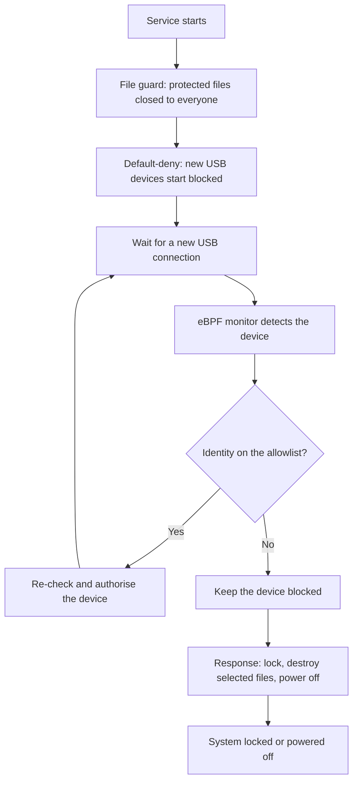

# PortWatchman

PortWatchman is an anti-forensics tool for Linux that reacts to unapproved USB
devices. It keeps every newly connected USB device blocked until its reported
identity matches an allowlist. While it runs, selected evidence files cannot be
opened, changed or deleted by anyone, including root. If an unapproved device is
connected, for example a forensic investigator's drive, imaging tool or keyboard,
the device stays blocked and PortWatchman runs a configured response: lock the
session, destroy the selected files, and power off.

Developed by team ForensicSherlocks for ICT3215 Digital Forensics at the Singapore
Institute of Technology. PortWatchman is an academic prototype; see
[Limitations](#limitations).

**Start here:** [Quick start](QUICKSTART.md) to set it up and test it, then the
[User manual](docs/USER-MANUAL.md) for full operating instructions.

## How it works



| Component | What it does | Code |
|---|---|---|
| Monitoring | Detects USB connections and disconnections with eBPF probes | `src/monitor/` |
| Identification and allowlisting | Reads the device's vendor ID, product ID and serial, and decides allow or block | `src/policy/` |
| USB access control | Sets default-deny on the USB buses and authorises only allowed devices | `src/enforcement/usb_authorization.py` |
| File guard (BPF-LSM) | Denies opening, changing or deleting selected VM files while the service runs | `src/enforcement/bpf/`, `src/enforcement/lsm_local.py` |
| Responses | Locks the session, destroys selected files and powers off when a device is blocked | `src/responses/` |
| Service | Runs and supervises all components, as a terminal command or a systemd service | `src/daemon/`, `systemd/` |

The file guard and the responses work in sequence: the guard keeps the selected
files closed while the system is live, and only the response stage is allowed
through it, so it can destroy them when an unapproved device appears.

## Requirements

| Requirement | Details |
|---|---|
| System | Ubuntu 24.04 (tested in a VMware virtual machine) |
| Kernel | eBPF and BTF support; BPF-LSM enabled for the file guard |
| Software | Python 3.10 or later (standard library only), bpftrace, and clang, bpftool, libbpf and json-c to build the file-guard controller |
| Permissions | root for live monitoring, enforcement and the service |

The Python components need no build step. The file-guard controller is a small C
program with an embedded BPF program, built for the target system with
`bash src/enforcement/bpf/build.sh` (see [Quick start](QUICKSTART.md) step A3).

## Documentation

| Document | Contents |
|---|---|
| [Quick start](QUICKSTART.md) | Setup and configuration (Part A) and functionality tests (Part B) |
| [User manual](docs/USER-MANUAL.md) | Installation, configuration, running as a service, allowlist, file guard, responses, logs, recovery, updates and limitations |
| [Testing setup](docs/TESTING-SETUP.md) | Shared preparation for the component test guides |
| [Step 3](docs/STEP3-TESTING.md) to [Step 9](docs/STEP9-TESTING.md) testing | Test procedures and recorded results for each component |
| [VM-file protection testing](docs/VM-FILE-PROTECTION-TESTING.md) | Verification of the file guard |
| [Enforcement notes](src/enforcement/README.md) | Internals of USB authorisation, the BPF-LSM controller and its socket protocol |

## Repository layout

```text
portwatchman/
├── QUICKSTART.md          # Setup and functionality tests
├── README.md              # This overview
├── config/                # Default and example configuration files
├── docs/                  # User manual and test guides
├── scripts/               # Service installer and quick-start configuration generator
├── src/
│   ├── monitor/           # eBPF USB monitor
│   ├── policy/            # Device identification and allowlist
│   ├── enforcement/       # USB authorisation; BPF-LSM file guard (bpf/)
│   ├── responses/         # Lock, delete, sanitise and power responses
│   └── daemon/            # Service supervisor
├── systemd/               # systemd unit
└── tests/                 # Unit tests and root-only BPF-LSM acceptance tests
```

Run the unit tests from the repository root:

```bash
python3 -m unittest discover -s tests -p 'test_*.py'
```

## Limitations

The main limits are summarised here; the [user manual](docs/USER-MANUAL.md#limitations)
lists them in full.

- Devices already connected when the service starts, including during boot, keep
  their access and are not re-checked.
- Vendor and product IDs and serial numbers are reported by the device and can be
  copied by a device that imitates an allowlisted one.
- A root user who knows PortWatchman is running can stop it before connecting a
  device, which releases the file guard and USB blocking without any response.
- Powering the machine off and imaging its disk (dead-box acquisition) bypasses
  PortWatchman entirely.
- File destruction overwrites and deletes the files, but copies may remain in
  snapshots, journals, SSD wear-levelling areas or the VM's disk file on the host.
- Responses run one after another; a slow action can delay later events beyond the
  two-second freshness limit.
- Testing covered an Ubuntu 24.04 VMware environment; other kernels, distributions
  and physical machines are not validated.
