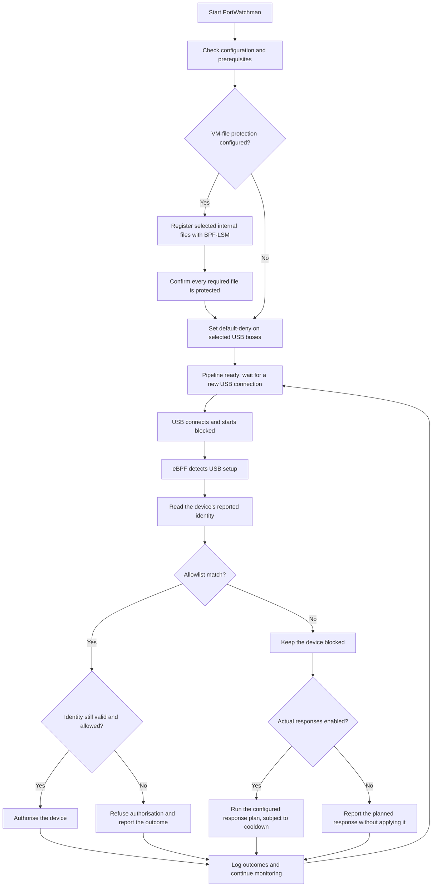

# PortWatchman User Manual

PortWatchman controls newly connected USB devices on Linux. It keeps devices on
selected USB buses blocked until their reported identity matches an allowlist.
An unapproved device remains blocked and can trigger a configured response, such
as locking the session. Optional BPF-LSM protection denies new opens of selected
files on the VM's internal filesystem, independently of USB connections.

This guide is for users operating the tool in an Ubuntu virtual machine or
reviewing its behaviour for a demonstration. PortWatchman is an academic prototype;
the [limitations](#limitations) describe the boundaries of its protection.

New to PortWatchman? Start with the [quick start](../QUICKSTART.md): Part A sets it
up and configures it, Part B tests each behaviour. For a project overview, see the
[README](../README.md).

## Contents

- [How it works](#how-it-works)
- [Requirements and installation](#requirements-and-installation)
- [Prepare your USB and configuration](#prepare-your-usb-and-configuration)
- [Run from the terminal](#run-from-the-terminal)
- [Install and operate the background service](#install-and-operate-the-background-service)
- [Manage the allowlist and enrol a new USB](#manage-the-allowlist-and-enrol-a-new-usb)
- [Protect selected files inside the VM](#protect-selected-files-inside-the-vm)
- [Configure response actions](#configure-response-actions)
- [Understand status and logs](#understand-status-and-logs)
- [Troubleshooting and recovery](#troubleshooting-and-recovery)
- [Update the installed tool](#update-the-installed-tool)
- [Limitations](#limitations)

## How it works



Configured VM-file protection must be registered successfully before service readiness.
It remains active across USB connections and disconnections. Component or
registration failures follow the recovery behaviour described below: the service
reports failure, stops its components and retains deny state for explicit recovery.

| When | PortWatchman does this |
|---|---|
| The service starts | Checks its configuration and prerequisites, starts the optional file-protection controller, and sets default-deny on the selected USB buses |
| The pipeline becomes ready | Reports `service_ready` and healthy status; the installed systemd unit reports running |
| A new USB connects | Reads its reported vendor ID, product ID and optional serial/port constraint |
| The device matches the allowlist | Revalidates its identity and authorises the device |
| VM-file protection is enabled | Registers the configured internal files before USB arming/readiness and checks their registrations approximately every second |
| The device does not match | Keeps it blocked and sends the result to the response component |
| A normal stop is requested | Releases file restrictions, stops components and restores the recorded original bus defaults |
| A component fails unexpectedly | Reports failure, stops the remaining components and retains default-deny for explicit recovery |

**Response preview does not disable USB enforcement.** A normal service run changes
USB authorisation even with `apply_responses: false`. That setting previews only
the response plan: for example, it reports a planned lock without locking the screen.
Configured VM-file restrictions also remain live when responses are in preview.

Use the service with the test USB **disconnected until readiness**. Devices already
connected retain their existing access and are not automatically re-evaluated or
enrolled in the legacy USB-file bridge at startup. Configured VM files are protected at startup regardless of connected devices. When using VMware, connect the USB to the
Ubuntu guest through VMware's USB/removable-device controls. Guest enforcement
does not protect the Windows host.

## Requirements and installation

### Supported environment

| Requirement | Details |
|---|---|
| Operating system | Validated on Ubuntu 24.04 under VMware on Windows |
| Kernel | Requires eBPF, BTF and the USB probe functions checked by the monitor; optional file protection also requires active BPF-LSM support |
| Validated kernel examples | `7.0.0-38-generic` and `7.0.0-43-generic`; other environments need their own checks |
| Python | Python 3.10 or later; application Python components use the standard library |
| Monitor | bpftrace; the recorded environment used `0.20.2` |
| Permissions | `sudo`/root for live monitoring, enforcement, service operation and controller access |
| Test files | Existing regular files on the VM disk for VM-file protection; a mounted USB filesystem only for legacy USB-file mode |

The application runs inside Linux. You may edit and push code on Windows, then
pull it into Ubuntu, but do not run the Linux enforcement commands on Windows.

### Obtain the repository and dependencies

All commands below use **Bash inside Ubuntu**. Replace every `REPLACE_WITH_...` or
`/path/to/...` placeholder before running it. Start clone-based commands from the
repository root; the installed `/opt/portwatchman` commands work from any directory.

```bash
sudo apt update
sudo apt install -y git python3 bpftrace usbutils udisks2 clang llvm \
  linux-tools-common build-essential pkg-config libbpf-dev libelf-dev libjson-c-dev

git clone 'REPLACE_WITH_REPOSITORY_URL' portwatchman
cd portwatchman
mkdir -p logs
```

If the repository is already cloned, use `cd '/path/to/portwatchman'` instead.
The native build dependencies are needed only when enabling file protection.

Check the environment:

```bash
python3 --version
uname -r
bpftrace --version
ls -l /sys/kernel/btf/vmlinux
sudo python3 src/monitor/usb_monitor.py --check
```

Expect a `monitor_preflight` record with `status: passed`. Stop and resolve a failed
preflight before starting enforcement.

For optional file protection, also check:

```bash
bpftool version
sudo cat /sys/kernel/security/lsm
```

The active LSM list must contain `bpf`. Ubuntu's `linux-tools-common` may supply a
bpftool launcher that still needs tools for the running kernel. If it reports
missing kernel tools, install the matching package **if available**:

```bash
sudo apt install "linux-tools-$(uname -r)"
bpftool version
```

If the package is unavailable, obtain a working bpftool for that environment
before building; the [upstream bpftool project](https://github.com/libbpf/bpftool)
documents its standalone build. Do not assume that `apt install bpftool` has an
installation candidate on Ubuntu. A missing `bpf` LSM entry requires a suitable
kernel/boot configuration; installing bpftool alone does not enable it.

### Configuration locations

| Location | Purpose |
|---|---|
| Repository `config/` | Shipped defaults and examples |
| Repository `logs/manual-*.json` | Local profiles created by this guide; ignored by Git |
| `/opt/portwatchman` | Installed runtime snapshot |
| `/etc/portwatchman` | Installed service, policy, enforcement, response and optional LSM configuration |
| `/var/lib/portwatchman/enforcement-state.json` | Installed service's saved original bus defaults |
| `/run/portwatchman/lsm_controller.sock` | Default root-only file-protection control socket |

The shipped allowlist is empty and its default action is `block`. The shipped
enforcement configuration selects buses automatically. For an initial demonstration,
use an explicit selected-bus profile as below; a bus may also contain a mouse,
keyboard or hub. Newly connecting peripherals on that bus are subject to its policy.

The service profile selects these configuration files:

| Field | Meaning |
|---|---|
| `policy` | Allowlist JSON file |
| `enforcement` | Managed buses and saved-state location |
| `responses` | Response plan JSON file |
| `local_lsm` | JSON file listing absolute VM file paths; `null` disables VM-file protection |
| `lsm` | Legacy USB-file bridge JSON file; keep `null` when using `local_lsm` |
| `apply_responses` | Boolean; `false` previews responses, `true` executes the plan |
| `startup_timeout` | Readiness timeout in seconds; default 90, allowed 1–120 |
| `shutdown_timeout` | Pipeline drain timeout in seconds; default 30, allowed 1–60 |
| `command_timeout` | Prerequisite command timeout in seconds; default 60, allowed 1–60 |

Relative file paths in service profiles and enforcement state paths are resolved
from the application code root, not the configuration file's directory. Use absolute
paths when explicitly configuring an installed service. Keep one schema version
(`schema_version: 1`) and use JSON booleans, not quoted strings.

## Prepare your USB and configuration

### Identify the intended device

With PortWatchman stopped, connect your intended drive to Ubuntu and run:

```bash
lsusb
python3 src/policy/device_policy.py list
lsblk -o NAME,TRAN,SIZE,FSTYPE,MOUNTPOINTS
```

Find the drive's `device_identified` JSON record. Confirm its manufacturer/product
and reported identity; do not select a VMware mouse, hub or root hub.

| Value | Meaning |
|---|---|
| `usb_id`, for example `3-2` | Device's current USB topology path; use the actual value from the JSON inventory |
| `bus`, for example `3` | Controller bus; its configuration name is `usb3` |
| `device_address` | Enumeration address; this is **not** the `usb_id` |
| `vendor_id`, `product_id`, `serial` | Reported attributes used by allowlist rules |
| `/dev/sdX1` | Storage partition shown by `lsblk`; separate from the USB ID |
| `USB_MOUNT` | Directory where that partition is mounted; separate from its block-device path |

Device paths, addresses, partitions and mount directories can change. Rediscover
them after reconnecting or changing VMware configuration.

```bash
USB_ID='REPLACE_WITH_DEVICE_USB_ID'
python3 src/policy/device_policy.py inspect "$USB_ID" > logs/manual-device.json
cat logs/manual-device.json
```

Continue only after inspection succeeds and the file describes the intended drive.

### Generate a selected-bus profile

This creates a matching allowlist, a lock-only response plan in preview mode,
and a service profile. It writes local configuration only; it does not arm a bus.
It refuses existing output files or saved arm state so an earlier profile is not
silently overwritten. If you already have a profile, edit it deliberately instead.

```bash
python3 - <<'PY'
import json
from pathlib import Path

files = {
    "policy": Path("logs/manual-allowlist.json"),
    "enforcement": Path("logs/manual-enforcement.json"),
    "responses": Path("logs/manual-responses.json"),
    "service": Path("logs/manual-service.json"),
}
state = Path("logs/manual-enforcement-state.json")
guarded = [*files.values(), state, Path(str(state) + ".service-owner.json")]
if any(path.exists() for path in guarded):
    raise SystemExit("Existing manual profile/state found; inspect and restore it before replacing it.")

device = json.loads(Path("logs/manual-device.json").read_text())["device"]
if device["is_root_hub"] or device["device_class"] == "09":
    raise SystemExit("Select the intended storage device, not a hub.")
rule = {
    "name": "trusted-usb",
    "vendor_id": device["vendor_id"],
    "product_id": device["product_id"],
}
if device.get("serial"):
    rule["serial"] = device["serial"]

documents = {
    "policy": {"schema_version": 1, "default_action": "block", "allowlist": [rule]},
    "enforcement": {
        "schema_version": 1,
        "managed_buses": ["usb" + str(device["bus"])],
        "state_file": str(state),
    },
    "responses": {
        "schema_version": 1,
        "cooldown_seconds": 30,
        "actions": [{"type": "lock_session"}],
    },
    "service": {
        "schema_version": 1,
        "policy": str(files["policy"]),
        "enforcement": str(files["enforcement"]),
        "responses": str(files["responses"]),
        "lsm": None,
        "apply_responses": False,
    },
}
for name, document in documents.items():
    files[name].write_text(json.dumps(document, indent=2) + "\n")
print("Created selected-bus profile: logs/manual-service.json")
PY

python3 src/daemon/portwatchman.py --config logs/manual-service.json validate
sudo python3 src/daemon/portwatchman.py --config logs/manual-service.json check
```

Expect `valid: true` and `service_preflight_passed`. `validate` checks configuration;
`check` runs prerequisite checks without arming the bus or leaving protection running.

If a device has no serial, the generated rule matches its vendor/product pair.
That permits other devices reporting the same pair. Serial matching narrows the
rule but does not authenticate physical hardware.

### Select the partition and mount directory

Read the actual values from `lsblk`, then set them in the terminal you are using:

```bash
USB_PARTITION='/dev/REPLACE_WITH_USB_PARTITION'
USB_MOUNT='/path/to/mounted/usb'
findmnt -T "$USB_MOUNT" -o SOURCE,TARGET,FSTYPE
```

Confirm the result identifies the USB partition and its mount, not the Linux root
filesystem. If authorised but not mounted, use `udisksctl mount -b "$USB_PARTITION"`
and read the actual mount directory. Shell variables do not automatically carry
over to another terminal.

## Run from the terminal

Unmount the drive successfully, then disconnect it:

```bash
udisksctl unmount -b "$USB_PARTITION"
```

Start the supervisor from the repository root:

```bash
sudo python3 src/daemon/portwatchman.py --config logs/manual-service.json run
```

Wait for `service_ready` before reconnecting the USB. In another terminal:

```bash
sudo python3 '/path/to/portwatchman/src/daemon/portwatchman.py' status
lsblk -o NAME,TRAN,SIZE,FSTYPE,MOUNTPOINTS
```

The matching drive should be authorised and available to mount. An unlisted drive
on the managed bus should remain unauthorised, with no usable storage partition;
the response plan is reported but not applied in preview mode.

Press **Ctrl+C in the supervisor terminal** to stop normally. Expect
`service_stopped` with `ok: true` and `buses_restored: true`. Inspect bus state:

```bash
python3 src/enforcement/usb_authorization.py \
  --config logs/manual-enforcement.json status
```

Expect `armed: false` and the recorded original bus default restored. A stopped
service status reports `running: false`, `healthy: false` and a nonzero status-command
exit code; that does not by itself mean shutdown failed.

For a lock-only demonstration after preview, this foreground override enables the
configured response plan for that run:

```bash
sudo python3 src/daemon/portwatchman.py \
  --config logs/manual-service.json run --apply-responses
```

An unapproved connection can now lock the Ubuntu screen. Unlock normally to review
the output. The override enables **all configured actions**, so review the response
plan first if you changed it. Do not run standalone pipelines or another controller
alongside the supervisor.

## Install and operate the background service

### Install once

The background service is the intended way to run PortWatchman. A foreground
`run` stops when its terminal is closed: its responses and file protection end,
while the USB buses stay in default-deny until restored. The service has no
terminal, keeps running when terminals are closed or the user logs out, and starts
at boot when enabled. The [quick start](../QUICKSTART.md) (step A7) generates a
ready profile, `logs/quick-service-deploy.json`, with the owner's USB allowed and
responses applied.

Stop any foreground run and restore its saved state before installation. If you
want optional file protection, prepare it using the next relevant section before
installing the profile.

```bash
sudo python3 scripts/install_service.py --config logs/manual-service.json
sudo systemd-analyze verify /etc/systemd/system/portwatchman.service

sudo python3 /opt/portwatchman/src/daemon/portwatchman.py \
  --config /etc/portwatchman/service.json validate
sudo python3 /opt/portwatchman/src/daemon/portwatchman.py \
  --config /etc/portwatchman/service.json check
```

Installation copies the runtime and configuration; it does **not** start the
service or enable boot startup. It leaves existing enablement unchanged. For an
existing installation, use the [update procedure](#update-the-installed-tool).

The installer writes absolute installed configuration paths and changes the
installed enforcement state path to `/var/lib/portwatchman/enforcement-state.json`.
The checkout and installed service therefore have separate configuration/state.
Editing `config/` or `logs/` in the clone does not change the installed service.

### Everyday commands

| Task | Command |
|---|---|
| Start | `sudo systemctl start portwatchman` |
| Inspect systemd status | `sudo systemctl status portwatchman --no-pager -l` |
| Inspect application health | `sudo python3 /opt/portwatchman/src/daemon/portwatchman.py status` |
| Stop normally | `sudo systemctl stop portwatchman` |
| Inspect last exit result | `sudo systemctl show portwatchman -p Result -p ExecMainStatus` |
| Read recent logs | `sudo journalctl -u portwatchman -n 100 --no-pager -o cat` |
| Follow live logs | `sudo journalctl -u portwatchman -f -o cat` |
| Follow live events as readable lines | `sudo python3 /opt/portwatchman/src/daemon/portwatchman.py follow` (add `--recent 50` for earlier events) |
| Switch the installed profile (stopped only) | `sudo python3 scripts/install_service.py --config PROFILE.json --replace-config` from the checkout |
| Check boot enablement | `systemctl is-enabled portwatchman` |

The log shows the monitor heartbeat, its policy health echo and the file-protection
status check only when their content changes (for example a new denied open or a
failure); unchanged repeats are still checked but not logged. Add `--log-all` to a
foreground `run` to see every record. The installed service logs JSON; `follow`
prints one short readable line per important event (USB allowed or blocked, denied
file opens, responses, problems and shutdown), the same as `--summary` does for a
foreground `run`.

`--replace-config` copies the new profile's configuration over the installed one
and removes optional files the new profile does not use. It refuses while the
service is running or while saved arm state exists; restore that state first.

Keep the USB disconnected at startup, wait for healthy readiness, then connect it.
Normal `systemctl start` waits for pipeline readiness, not just creation of a Python
process. Normal `systemctl stop` releases selected-file protection before restoring
the saved bus defaults. Stop the service before unmounting if you do not need to
keep monitoring other devices.

### Enable actual responses

```bash
sudo systemctl stop portwatchman
sudoedit /etc/portwatchman/service.json
```

Change `"apply_responses": false` to `"apply_responses": true`. Review the actions:

```bash
sudo python3 /opt/portwatchman/src/responses/responses.py \
  --config /etc/portwatchman/responses.json validate
sudo python3 /opt/portwatchman/src/daemon/portwatchman.py \
  --config /etc/portwatchman/service.json validate
sudo systemctl start portwatchman
```

Continue to startup only if validation succeeds. To return to preview, stop, set
the value to `false`, validate and start again. Response settings are loaded at
process start; changing the JSON alone does not update a running response process.

### Start automatically at boot

After verifying manual startup with preview responses and the intended bus mapping:

```bash
sudo systemctl enable portwatchman
```

This enables future boot startup; it does not start an inactive service now. After
the next normal reboot, inspect status and the current boot's logs:

```bash
sudo systemctl status portwatchman --no-pager -l
sudo journalctl -b -u portwatchman --no-pager -o cat
```

To stop and disable automatic startup:

```bash
sudo systemctl disable --now portwatchman
```

Protection then stays on across reboots until you disable it. A normal shutdown
stops the service cleanly; after a forced power-off, VMware reset or a `force`/
`immediate` power response, the next boot sets the old boot's arm state aside and
arms again instead of refusing to start. `systemctl stop` alone lasts only until
the next boot; use `disable --now` to turn protection off for good.

Boot startup does not guarantee protection before readiness or automatically
process devices already present. Bus numbering can change. VM files must already
exist and their internal filesystem must be mounted at service startup. Only the
legacy USB-file mode waits for an approved USB mount; unattended USB mounting is
not provided.

## Manage the allowlist and enrol a new USB

### Rule matching

Each rule requires a unique `name`, a quoted four-digit hexadecimal `vendor_id`
and `product_id`. Optional `serial` and `usb_id` constraints narrow the match.
Every constraint in a rule must match; the first matching rule wins. Serial matching
is exact and case-sensitive. `usb_id` constrains a current port/topology path, not
a permanent physical identity. The default action must remain `block`.

These commands display identity and decisions without authorising a device:

```bash
sudo python3 /opt/portwatchman/src/policy/device_policy.py list

USB_ID='REPLACE_WITH_CURRENT_USB_ID'
sudo python3 /opt/portwatchman/src/policy/device_policy.py inspect "$USB_ID"

sudo python3 /opt/portwatchman/src/policy/device_policy.py \
  --policy /etc/portwatchman/allowlist.json evaluate "$USB_ID"
```

An `action: allow` policy result is a decision, not a write to the kernel. Its
`enforcement_applied: false` is expected when using `evaluate`.

### Enrol a device that has never been allowed

Default-deny prevents normal device use; the USB identity attributes remain
available for inspection. You can identify and enrol a blocked drive without
temporarily allowing its storage. An applied response may lock the screen when
it first connects; unlock and inspect it normally.

1. Connect the intended drive and inspect it using `list` and `inspect` above.
2. Stop the service before editing its configuration. This restores its bus
   defaults, so future connections are no longer gated while it is stopped.
3. Add a rule using the inspected values. Do not copy another drive's serial.

```bash
sudo systemctl stop portwatchman

VENDOR_ID='REPLACE_WITH_4_HEX_DIGITS'
PRODUCT_ID='REPLACE_WITH_4_HEX_DIGITS'
SERIAL='REPLACE_WITH_EXACT_REPORTED_SERIAL'

sudo python3 /opt/portwatchman/src/policy/device_policy.py \
  --policy /etc/portwatchman/allowlist.json add-rule \
  --name additional-trusted-usb \
  --vendor-id "$VENDOR_ID" --product-id "$PRODUCT_ID" --serial "$SERIAL"

sudo python3 /opt/portwatchman/src/policy/device_policy.py \
  --policy /etc/portwatchman/allowlist.json validate
sudo python3 /opt/portwatchman/src/daemon/portwatchman.py \
  --config /etc/portwatchman/service.json validate
```

If no serial is reported, omit `--serial "$SERIAL"` and understand the broader match.
For an existing rule, use `sudoedit /etc/portwatchman/allowlist.json`; duplicate rule
names are rejected. Also confirm the new device's bus is in the installed
`enforcement.json` `managed_buses` list. Stop and reconfigure explicitly if it is not.

After successful validation, disconnect the blocked drive, start the service, wait
for readiness and reconnect. The new connection is evaluated using the rule.
Changing a rule does not automatically re-evaluate a connection already processed.
VM-file protection does not need an allowlist mapping. Only legacy USB-file mode
uses optional file-protection mappings for allowed devices.

To remove a rule while stopped:

```bash
sudo python3 /opt/portwatchman/src/policy/device_policy.py \
  --policy /etc/portwatchman/allowlist.json remove-rule \
  --name additional-trusted-usb
```

For legacy USB-file mode, keep mappings consistent: every `allowlist_rule` must name
an existing policy rule. Update the bridge configuration or disable its `lsm`
setting before removing its last mapping. Validate the complete service profile.
Removing a rule alone does not revoke an already-authorised device.

### Recover access to an already blocked device

Restoring bus defaults does not authorise a device that is already blocked. With
the service stopped and a matching policy, first preview, then explicitly apply:

```bash
sudo python3 /opt/portwatchman/src/enforcement/usb_authorization.py \
  --config /etc/portwatchman/enforcement.json \
  --policy /etc/portwatchman/allowlist.json authorize "$USB_ID"

sudo python3 /opt/portwatchman/src/enforcement/usb_authorization.py \
  --config /etc/portwatchman/enforcement.json \
  --policy /etc/portwatchman/allowlist.json authorize "$USB_ID" --apply
```

This authorises according to policy. VM-file protection is managed separately by
the service and does not depend on this command or a new USB connection.

## Protect selected files inside the VM

The BPF-LSM guard blocks **new data opens of explicitly selected regular files on
the VM's internal filesystem**. Protection starts before service readiness and
does not depend on a USB being connected, authorised, mounted or disconnected.
USB allow/block decisions continue separately.

The same denial applies to ordinary applications and root processes. This is not
a trusted-application policy, malware detector, general copying firewall or memory
dump prevention mechanism. Use disposable demonstration files first. Do not select
the interpreter, service code/configuration, system programs or files needed to
operate the VM.

Protected files can also be listed in a delete response (see [Configure response
actions](#configure-response-actions)). When the service starts its response stage,
it exempts that one process from the guard, so on an unapproved USB the response
alone can overwrite and delete them; every other process, including root, is still
denied. The exemption ends when the response stage exits. A protected file that
has been destroyed is reported (`service_protected_file_destroyed`) and its guard
entry released, while the other files stay protected. A protected file that is
missing when the service starts is skipped (`service_protected_file_missing`), so
the other files and USB blocking still start.

### Build the controller

With PortWatchman stopped, run in the Ubuntu clone:

```bash
bash src/enforcement/bpf/build.sh
sudo src/enforcement/bpf/build/lsm_controller --check
```

Warnings from the generated `vmlinux.h` kernel header are harmless. Then verify the
build with the automated tests; the second command loads the guard and tests it on
disposable files only:

```bash
python3 -m unittest discover -s tests -p 'test_*.py'
sudo python3 tests/enforcement/test_bpf_lsm.py --local
```

Expect `OK` from the unit tests and `All BPF-LSM acceptance checks passed` from the
guard tests. Rebuild and repeat both after updating the code.

### Create disposable VM files and a local profile

The following uses the manual's previously prepared `logs/manual-service.json`
profile. It creates files inside the checkout on the VM disk, not on the USB.
For another profile, change `service_path` to that already validated profile.

```bash
python3 - <<'PY'
import json
from pathlib import Path
import tempfile

service_path = Path("logs/manual-service.json")
service = json.loads(service_path.read_text())
if service.get("lsm") is not None or service.get("local_lsm") is not None:
    raise SystemExit("Existing file-protection configuration found; edit it explicitly.")
base = Path("build/test-tmp").resolve()
base.mkdir(parents=True, exist_ok=True)
fixture = Path(tempfile.mkdtemp(prefix="portwatchman-vm-", dir=base))
(fixture / "restricted.txt").write_text("Protected VM file\n")
(fixture / "control.txt").write_text("Readable VM control\n")
local_path = Path("logs/manual-lsm-local.json")
with local_path.open("x") as output:
    json.dump({
        "schema_version": 1,
        "socket_path": "/run/portwatchman/lsm_controller.sock",
        "protected_paths": [str(fixture / "restricted.txt")],
    }, output, indent=2)
    output.write("\n")
service["lsm"] = None
service["local_lsm"] = str(local_path)
service_path.write_text(json.dumps(service, indent=2) + "\n")
print("Restricted VM file:", fixture / "restricted.txt")
print("Readable control:", fixture / "control.txt")
PY

python3 src/daemon/portwatchman.py --config logs/manual-service.json validate
sudo python3 src/daemon/portwatchman.py --config logs/manual-service.json check
```

The example format is also in `config/lsm-local.example.json`; its example target
must exist before it can pass live preflight. Paths must be canonical absolute
Linux paths to existing individual files. Directories, symlink components,
traversal, USB-backed filesystems, loop devices and pseudo filesystems are refused.
At most 128 distinct file identities can be registered. Internal block devices,
including the guest root filesystem and verified non-USB stacked devices, are
eligible. No protected files are created automatically by the running service.

### Start and inspect

Start with the test USB disconnected, as for ordinary USB enforcement:

```bash
sudo python3 src/daemon/portwatchman.py --config logs/manual-service.json run
```

In a second terminal:

```bash
sudo python3 src/daemon/portwatchman.py status
sudo python3 src/enforcement/lsm_client.py STATUS
cat '/absolute/path/printed/above/restricted.txt'
cat '/absolute/path/printed/above/control.txt'
```

Replace the example paths with the actual paths printed during preparation.
Expect `lsm_scope: "vm-files"`, controller `mode: "local-files"`, a startup
`lsm_local_registered` event with `protection_complete: true`, and the correct
targets. The restricted file must return `Permission denied` even before USB
insertion; the control must remain readable. A denied open increases
`denied_opens`. `enforcement_active: true` alone does not prove any file is enrolled.
Local target `usb_id` is `null`; its protocol `connection_id` is a `local:` service
ownership identifier, not a USB connection.

Connect the approved drive, check authorisation, then unmount and disconnect it
normally. Repeat both VM file reads: the same VM files must remain protected.
An unapproved USB should still remain blocked and trigger the configured response
or preview. VM-file denial itself does not trigger a response action.

Stop the foreground service with Ctrl+C. After normal shutdown, the restricted
file should be readable again and the original USB bus defaults restored. Loss of
a required registration or controller causes a service failure, not a successful
ready state or silent re-registration. As before, controller exit detaches the
guard; VM protection does not survive a stopped or failed controller.

### Update an existing installed service

Checkout changes do not update `/opt/portwatchman` or `/etc/portwatchman` by themselves.
Stop the installed service, rebuild the native controller, and update installed
code using the installer. Installed configuration is preserved:

```bash
sudo systemctl stop portwatchman
bash src/enforcement/bpf/build.sh
sudo python3 scripts/install_service.py --update-code
sudo install -o root -g root -m 600 logs/manual-lsm-local.json /etc/portwatchman/lsm-local.json
sudoedit /etc/portwatchman/service.json
```

Set `"local_lsm": "/etc/portwatchman/lsm-local.json"` and `"lsm": null` in the
installed service profile. Keep the policy, bus and response settings appropriate
for your environment. The protected VM paths remain absolute paths to the files
you selected; the installer does not relocate those files.

```bash
sudo python3 /opt/portwatchman/src/daemon/portwatchman.py --config /etc/portwatchman/service.json validate
sudo python3 /opt/portwatchman/src/daemon/portwatchman.py --config /etc/portwatchman/service.json check
sudo systemctl start portwatchman
sudo python3 /opt/portwatchman/src/daemon/portwatchman.py status
sudo python3 /opt/portwatchman/src/enforcement/lsm_client.py STATUS
```

Use `systemctl stop portwatchman` to release installed-service protection normally.
Do not stop its controller separately or use `PREPARE_REMOVE`: that command is for
the legacy USB-file mode and is rejected in VM-file mode.

### Existing USB-file mode

Older profiles using `lsm` and `config/lsm-bridge.example.json` continue to restrict
selected files on an approved USB after mounting. That is a separate mode, with
USB connection ownership and `PREPARE_REMOVE` before unmounting a protected drive.
It is not VM-file protection. A service profile must choose either `local_lsm` or
legacy `lsm`; both cannot be enabled together. See
[the legacy bridge guide](STEP6-TESTING.md) for that mode, and
[VM-file verification](VM-FILE-PROTECTION-TESTING.md) for the current VM use.

## Configure response actions

The response plan runs on a qualifying blocked-device result, not on an approved
connection or merely on a file-open denial. It uses a global cooldown within the
response process (default 30 seconds), so another blocked device during that window
may have its response suppressed while remaining blocked.

| Action | Configuration | Effect when applied |
|---|---|---|
| `lock_session` | `{"type":"lock_session"}` | Runs `loginctl lock-sessions`; locks sessions on the Ubuntu guest |
| `delete` | `paths`, `passes`, and top-level `allowed_roots` | Best-effort overwrite/removal of selected paths strictly inside chosen roots |
| `sanitise` | `home_dirs`, `items`, `passes` | Cleans selected activity traces; `drop_caches` is system-wide cache dropping |
| `power` | `mode`: `poweroff` or `reboot`; `method`: `graceful`, `force` or `immediate` | Requests guest shutdown/reboot using the configured method |

Actions run in array order, each type may appear once, and `power` must be last.
Overwrite `passes` accepts integers 1–7; more passes do not establish secure erasure
on flash storage, snapshots or other retained copies. `force` skips normal unit
shutdown; `immediate` uses SysRq and can bypass normal service cleanup. Use a
lock-only plan for routine operation and disposable data for cleanup demonstrations.

A lock-only installed configuration is:

```json
{
  "schema_version": 1,
  "cooldown_seconds": 30,
  "actions": [{"type": "lock_session"}]
}
```

For optional cleanup, the following is a **template**. Replace the paths with
owned disposable directories and review the scope before enabling it:

```json
{
  "schema_version": 1,
  "cooldown_seconds": 30,
  "allowed_roots": ["/absolute/path/to/disposable-demo"],
  "actions": [
    {"type": "lock_session"},
    {
      "type": "delete",
      "paths": ["/absolute/path/to/disposable-demo/selected"],
      "passes": 1
    },
    {
      "type": "sanitise",
      "home_dirs": ["/absolute/path/to/disposable-home"],
      "items": ["recent_files", "thumbnails", "shell_history", "trash"],
      "passes": 1
    },
    {"type": "power", "mode": "poweroff", "method": "graceful"}
  ]
}
```

Sanitisation item names are `recent_files`, `thumbnails`, `shell_history`, `trash`
and `drop_caches`. `home_dirs` scopes the trace paths independently of deletion's
`allowed_roots`; neither setting scopes the system-wide cache drop. A cache-only
sanitisation action may omit `home_dirs`. Cache dropping is not RAM sanitisation.

To preview an installed plan without triggering it through a USB:

```bash
sudo python3 /opt/portwatchman/src/responses/responses.py \
  --config /etc/portwatchman/responses.json validate
sudo python3 /opt/portwatchman/src/responses/responses.py \
  --config /etc/portwatchman/responses.json trigger
```

Both commands avoid applying response actions. To test only a configured lock:

```bash
sudo python3 /opt/portwatchman/src/responses/responses.py \
  --config /etc/portwatchman/responses.json run-action lock_session --apply
```

This locks the screen immediately. A manual `trigger --apply` would execute the
entire configured plan immediately, including deletion or power actions, without
waiting for USB input. Manual command invocations do not share cooldown state with
the running response process.

## Understand status and logs

The service writes one JSON record per line to the terminal or systemd journal.
Component records appear inside a `service_stage_event` wrapper with a `stage`
and nested `event`. A record forwarded through two stages can be logged twice;
check connection/target identity before interpreting that as two operations.

| Record or field | Interpretation |
|---|---|
| `service_ready` | Startup readiness completed |
| `running: true`, `healthy: true` | Supervisor is alive and no observed pipeline failure has invalidated its established running state |
| `enforcement_result`, `action: allow` | Device decision/action; verify authorisation and the block device when checking actual access |
| `action: block`, `reason: already_blocked` | Device was already unauthorised; `enforcement_applied: false` here does not mean it was allowed |
| Device `kernel_authorized: false` inside an allow result | The identity snapshot may have been captured before authorisation; read current sysfs state to confirm |
| `lsm_local_registered` | Configured VM files registered before service readiness |
| `lsm_bridge_pending` | Legacy USB-file mode: waiting for the mounted filesystem and files |
| `lsm_bridge_registered`, `protection_complete: true` | Files registered with the current controller |
| `response_action`, `applied: false` | Response preview |
| `response_action`, `applied: true`, `ok: true` | Action reported success; a power-command result is not proof of total shutdown latency |
| `response_suppressed`, `reason: cooldown` | Response skipped due to cooldown; USB blocking remains separate |
| `service_stopped`, `ok: true`, `buses_restored: true` | Normal cleanup and saved bus restoration completed |
| `service_bus_state_retained` or failed stop | Inspect the failure and use the owning profile's recovery command |

Read the current USB state using rediscovered values:

```bash
cat "/sys/bus/usb/devices/$USB_ID/authorized"
grep -H . /sys/bus/usb/devices/usb*/authorized_default
lsblk -o NAME,TRAN,SIZE,FSTYPE,MOUNTPOINTS
```

`authorized: 0` means the device is unauthorised; `1` means authorised. A managed
bus default of `0` gates new connections; it does not revoke devices already
authorised. These are Linux USB authorisation attributes, described in the
[kernel USB authorisation documentation](https://docs.kernel.org/usb/authorization.html).

## Troubleshooting and recovery

| Symptom | What to check or do |
|---|---|
| `Device or required attributes unavailable` | Run `list` again; the selected USB ID may be wrong, disconnected or now assigned to another device |
| Drive is absent from `lsblk` | Check whether it is intentionally blocked and whether its inspected identity matches the selected policy |
| Legacy USB-file protection is pending | Check the current mount, existing relative paths and rule name; mount before the registration timeout |
| VM-file preflight or registration fails | Check the absolute file paths, non-USB block-backed filesystem, absence of symlinks, rebuilt controller and separate cleanup targets |
| Selected file remains readable | Confirm registration and active target identity; replacement files and pre-existing data descriptors are outside the guard's scope |
| Unmount says `target is busy` | For legacy USB-file mode, prepare that USB connection for removal; for VM-file mode, USB removal needs no LSM command. Close other applications using the mount |
| No screen lock | Confirm `apply_responses`, the lock action, the blocked result, cooldown and an available lockable session |
| Ownership-lock error | An existing service/check/install/restore operation owns the runtime lock; inspect it rather than deleting the lock file |
| Existing arm state or LSM socket refused | Identify and stop its owner, inspect logs, and restore with the exact original configuration |
| `bpftool` unavailable or native preflight fails | Resolve tools, BTF and active BPF-LSM prerequisites before enabling file protection |
| Invalid JSON or unknown field | Use boolean `true`/`false`, schema version 1 and supported fields; validate before starting |
| `lsm_bridge_error` after controller exit | File protection no longer survives that controller; inspect and recover the owning service |
| `response_input_error` after a long action | The known input-age limitation may have rejected delayed records; inspect failed service state and recover normally |

### Recover after a failed installed service

The service intentionally retains default-deny after unexpected failure. It does
not automatically restart. First inspect its journal, then stop any remaining
components through the owner:

```bash
sudo journalctl -u portwatchman -n 100 --no-pager -o cat
sudo systemctl stop portwatchman

pgrep -af 'lsm_controller|bpftrace.*usb_events[.]bt|src/daemon/portwatchman[.]py.*run'
```

Continue only after its component processes have exited. Restore using the installed
profile, not the checkout's separate state:

```bash
sudo python3 /opt/portwatchman/src/daemon/portwatchman.py \
  --config /etc/portwatchman/service.json restore

sudo python3 /opt/portwatchman/src/enforcement/usb_authorization.py \
  --config /etc/portwatchman/enforcement.json status

sudo systemctl reset-failed portwatchman
```

Expect `armed: false` and the saved original defaults restored. The original value
need not be `1`; do not replace it with a guessed value. After resolving the cause,
disconnect the test drive, start the service and wait for readiness before reconnecting.

For a failed foreground run using this guide's local profile, the owning command is:

```bash
sudo python3 src/daemon/portwatchman.py --config logs/manual-service.json restore
```

Recovery refuses foreign/manual state. Saved service state from an **earlier boot**
is different: USB default-authorisation values live in sysfs and every boot resets
them, so there is nothing to write back. The next service start (or `restore`) sets
that state aside as `<state file>.previous-boot-<id>` and reports
`service_previous_boot_state_cleared`; `check` only reports
`service_previous_boot_state_found`. State from the **current** boot is still
refused unless its owner restores it. **Do not delete saved state, ownership records
or sockets to bypass a refusal.**

## Update the installed tool

The installed runtime is a snapshot. A Git pull does not update it, and code updates
preserve installed configuration. From the reviewed Ubuntu clone:

```bash
sudo systemctl stop portwatchman
git status
git pull --ff-only
```

Handle local changes before pulling and use the intended release/branch. If native
sources or the target kernel changed and you use file protection, rebuild and check:

```bash
bash src/enforcement/bpf/build.sh
sudo src/enforcement/bpf/build/lsm_controller --check
```

Then update the runtime snapshot and check its installed profile:

```bash
sudo python3 scripts/install_service.py --update-code
sudo python3 /opt/portwatchman/src/daemon/portwatchman.py \
  --config /etc/portwatchman/service.json validate
sudo python3 /opt/portwatchman/src/daemon/portwatchman.py \
  --config /etc/portwatchman/service.json check
sudo systemctl start portwatchman
```

Start only after checks pass and earlier saved arm state has been restored. The
installer does not replace existing policies or enable/disable boot startup during
an update. Change installed settings explicitly while stopped and validate them.

## Limitations

- Only the configured buses are managed (`"auto"` manages every bus). Current startup handling covers new connections
  after readiness; existing devices and pre-start access are not automatically
  reconciled or revoked. There is no complete boot-time prevention guarantee.
- Vendor/product IDs and serials are reported by devices and can be spoofed.
  An allowlist match does not authenticate physical hardware.
- USB authorisation controls whole devices. There is no per-interface policy or
  general composite-device/HID firewall in this application.
- File protection follows registered regular-file identities through rename/hardlinks,
  but does not automatically enrol replacement files. While protected, a file cannot
  be deleted, replaced by a rename or truncated, even by root. It does not cover pre-existing
  data descriptors, mmap, raw-device access or whole volumes. VM files are enrolled
  before service readiness; legacy USB-file mode registers after authorisation/
  mounting. Controller exit removes either mode's restrictions. The only exemption
  is the service's own response stage, granted by process ID while that process runs;
  any root process able to reach the controller socket could request one, but root
  can already stop the service. No general memory-dump prevention is provided.
- The service does not mount filesystems. The verified boot use involves a desktop
  session and a drive connected after readiness; unattended mounting is not provided.
- Responses run synchronously. A long action can delay reading later events beyond
  the two-second freshness limit, causing valid closes or later response triggers
  to be rejected. USB default-deny remains separate; the service can report failure
  and require manual recovery. The global cooldown can also suppress later responses.
- There is no independent end-to-end watchdog for a frozen pipeline stage. Healthy
  status reflects the established state and errors observed so far.
- Cleanup is best effort. Flash wear levelling, host/VM snapshots and other copies
  prevent a guarantee of forensic erasure. Dropping caches does not sanitise RAM.
- Kernel/distribution compatibility, long-duration workloads, simultaneous devices
  and forced-power-loss recovery are not comprehensively validated. Journal output
  is not a tamper-resistant audit store. VMware results describe guest behaviour.

For background on the optional kernel mechanism, see the
[Linux BPF-LSM documentation](https://docs.kernel.org/bpf/prog_lsm.html).
